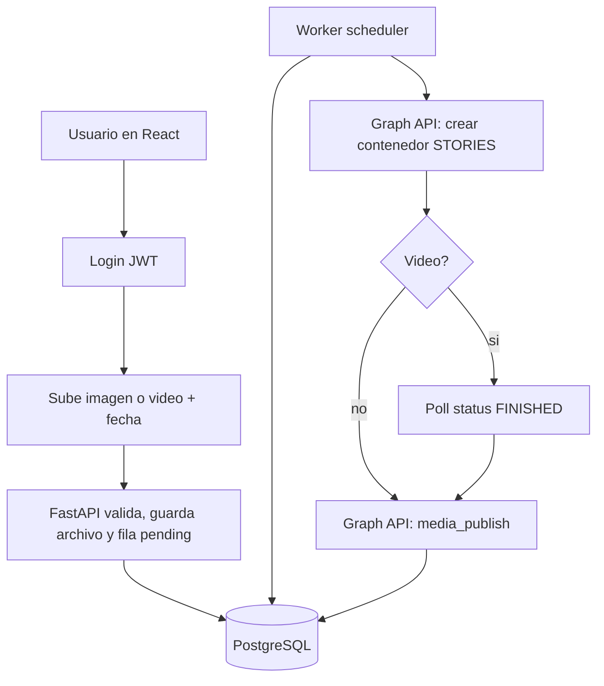

# Documento de diseño: App para automatizar Stories de Instagram

Aplicación web propia para subir una imagen o video, programar fecha y hora, y publicarlo automáticamente como Story en **una** cuenta de Instagram Business/Creator.

Estado: diseño cerrado (stack y producto). La implementación del código es la siguiente fase.

## 1. Objetivo

Una app web con login donde puedas:

- Subir una imagen o video.
- Elegir la fecha y hora de publicación (zona `America/Bogota`).
- Ver un calendario/listado con lo programado, publicado y fallido.
- Cancelar una publicación mientras siga pendiente.
- Que el sistema publique en Instagram a la hora indicada, sin intervención manual.

Fuera de alcance: varias cuentas de Instagram, Feed, Reels, y publicar desde `localhost` (Instagram no puede descargar el archivo).

## 2. Stack cerrado

| Capa | Tecnología |
|---|---|
| Frontend | React + TypeScript + Vite |
| Backend | Python FastAPI, Pydantic v2, SQLAlchemy 2, Alembic |
| Auth | Login usuario/contraseña; JWT Bearer |
| Base de datos | PostgreSQL |
| HTTP a Instagram | `httpx` a `{IG_GRAPH_HOST}/{IG_GRAPH_VERSION}` (por defecto `https://graph.facebook.com/v22.0`) |
| Scheduler | Worker en el mismo repo (loop ~30 s) con `SELECT … FOR UPDATE SKIP LOCKED` |
| Tope Graph | `GET /{ig-user-id}/content_publishing_limit`; si falla, conteo local 100 / 24 h |
| Archivos | Disco local `media/`, servidos por FastAPI en HTTPS público |
| Zona horaria | `America/Bogota` (UTC−5), env `APP_TIMEZONE` |
| Docs de API | FastAPI nativo: `/docs` y `/redoc` |

Estructura prevista del repo:

```
backend/     FastAPI, worker, Alembic
frontend/    React + Vite
media/       archivos subidos (no se versionan)
.cursor/     reglas y skills del agente
```

### Hosting (único punto aún abierto de proveedor)

Requisitos, no el nombre del proveedor:

- Proceso largo: API + worker (no serverless para el backend).
- PostgreSQL.
- Volumen persistente para `media/`.
- HTTPS público (`APP_PUBLIC_BASE_URL`) para que Instagram descargue el archivo.

Encaja VPS, Railway, Render o Fly. **No** Vercel para el backend (el scheduler no es una función efímera). El frontend estático sí puede servirse detrás del mismo origen o de nginx.

## 3. Componentes

### 3.1 Interfaz web (React)

Tres superficies, todas tras login salvo la propia pantalla de login:

- **Login**: usuario y contraseña.
- **Formulario de carga**: archivo (imagen o video) + fecha/hora. Validación de formato Instagram **antes** de enviar. Si el token está por vencer (≤ 7 días), aviso visible.
- **Calendario / listado**: publicaciones con estado `pending` | `publishing` | `published` | `failed`. Cancelar solo si `pending`.

Copy en español, verbos de usuario (“Programar Story”, “Cancelar”), no jerga de la API.

### 3.2 Servidor (FastAPI)

- Recibe el archivo, valida, lo guarda en `media/`.
- Crea la fila en PostgreSQL con `scheduled_at` y estado `pending`.
- Expone el archivo en `GET /media/{filename}` **sin auth** (Instagram lo descarga por HTTPS).
- El resto de `/api/*` (salvo login) exige sesión.
- Expone estado del token/cuenta para la UI.

### 3.3 Base de datos

Solo metadata; el binario vive en disco.

**`users`** (un registro en la práctica):

- `id`
- `username`
- `password_hash`

**`scheduled_stories`**:

- `id` (UUID o serial)
- `filename` (ruta relativa en `media/`)
- `media_type` (`image` | `video`)
- `scheduled_at` (`timestamptz`)
- `status` (`pending` | `publishing` | `published` | `failed`)
- `instagram_media_id` (nullable)
- `error_message` (nullable)
- `created_at` (`timestamptz`)

Credenciales de Instagram **no** van en tablas: solo env `IG_ACCESS_TOKEN`, `IG_USER_ID`, `APP_PUBLIC_BASE_URL`.

### 3.4 Worker (scheduler)

Proceso aparte (misma imagen Docker, otro comando). Cada ~30 s:

1. Toma filas `pending` con `scheduled_at <= now()` usando `SELECT … FOR UPDATE SKIP LOCKED`.
2. Las marca `publishing` en la misma transacción.
3. Llama a Instagram (contenedor → si video, poll → `media_publish`).
4. Actualiza a `published` (guarda `instagram_media_id`) o `failed` (`error_message`).

Sin reintentos infinitos. El lock evita doble publicación si hay dos workers.

### 3.5 Integración Instagram

Instagram Graph API de Meta, cuenta Business/Creator única. Flujo de dos pasos, media `STORIES`. Detalle operativo en `.cursor/skills/instagram-stories-api/SKILL.md`.

## 4. Flujo de principio a fin



1. Login en la UI.
2. Subes archivo y eliges fecha/hora (`America/Bogota`).
3. FastAPI valida formato y tope de 100 publicaciones Graph / 24 h; guarda archivo y fila `pending`.
4. El worker reclama la fila cuando llega la hora.
5. Instagram descarga `{APP_PUBLIC_BASE_URL}/media/{filename}`, procesa y publica la Story.
6. El registro pasa a `published` o `failed`.
7. El calendario refleja el estado; si falló, el mensaje es el de la API o la validación.

## 5. Contrato de API

Auth en `/api/*` excepto `POST /api/auth/login`. `/media/{filename}` es público.

| Método | Ruta | Notas |
|---|---|---|
| `POST` | `/api/auth/login` | usuario + contraseña → sesión |
| `POST` | `/api/auth/logout` | invalida sesión |
| `GET` | `/api/auth/me` | usuario actual |
| `POST` | `/api/stories` | multipart: archivo + `scheduled_at`; 201 |
| `GET` | `/api/stories` | listado (filtro opcional por estado) |
| `DELETE` | `/api/stories/{id}` | solo si `pending`; 409 si no |
| `GET` | `/api/instagram/status` | token/cuenta; aviso de vencimiento |
| `GET` | `/media/{filename}` | público, HTTPS, para Instagram |
| — | `/docs`, `/redoc` | OpenAPI generado |

Errores de validación (formato, tope diario, fecha en el pasado) se responden en el `POST /api/stories` con mensaje claro para el formulario. No se encolan para fallar de madrugada.

## 6. Validación de media (antes de guardar)

| | Imagen | Video |
|---|---|---|
| Formato | JPEG (PNG solo si se convierte a JPEG antes de enviarlo a IG) | MP4 o MOV, H.264/HEVC, AAC |
| Tamaño | ≤ 8 MB | ≤ 100 MB |
| Duración | — | 3–60 s |
| FPS | — | 23–60 |
| Aspecto | 9:16 recomendado; ancho mín. 500 px | 9:16 recomendado |
| Recomendado | 1080×1920 | 1080×1920 |

## 7. Infraestructura y operaciones

- **HTTPS público.** `APP_PUBLIC_BASE_URL` es el origen real (no `http://localhost`) en el entorno que publica.
- **Almacenamiento.** Los archivos permanecen al menos hasta publicar; después pueden borrarse (las Stories caducan a las 24 h en Instagram).
- **Token ~60 días.** `GET /api/instagram/status` alimenta el aviso en UI. Renovación long-lived cuando Meta lo permita (`fb_exchange_token`). Fallo de renovación visible, no silencioso.
- **Límite Graph / 24 h.** Fuente: `GET /{ig-user-id}/content_publishing_limit`. Si no está disponible, contar `published` + `publishing` de las últimas 24 h (tope 100) más las `pending`.
- **Fallos.** Instagram rechaza → `failed` + `error_message`. Sin reintento indefinido.
- **Seguridad.** Login obligatorio. Secretos solo en env del backend. `/media/` no lista directorios; solo archivos conocidos por nombre.

## 8. Decisiones cerradas

- Una cuenta Instagram (`IG_USER_ID`).
- PostgreSQL (no SQLite).
- Login simple obligatorio.
- FastAPI + React + Vite + TypeScript.
- Timezone `America/Bogota`.
- Worker con lock, no cron de sistema como mecanismo principal.
- Multi-cuenta: no.

## 9. MVP implementado

El código vive en `backend/` + `frontend/`. Arranque, Meta y túnel HTTPS: [README.md](README.md). El proveedor de hosting se elige al desplegar, cumpliendo la sección 2.
